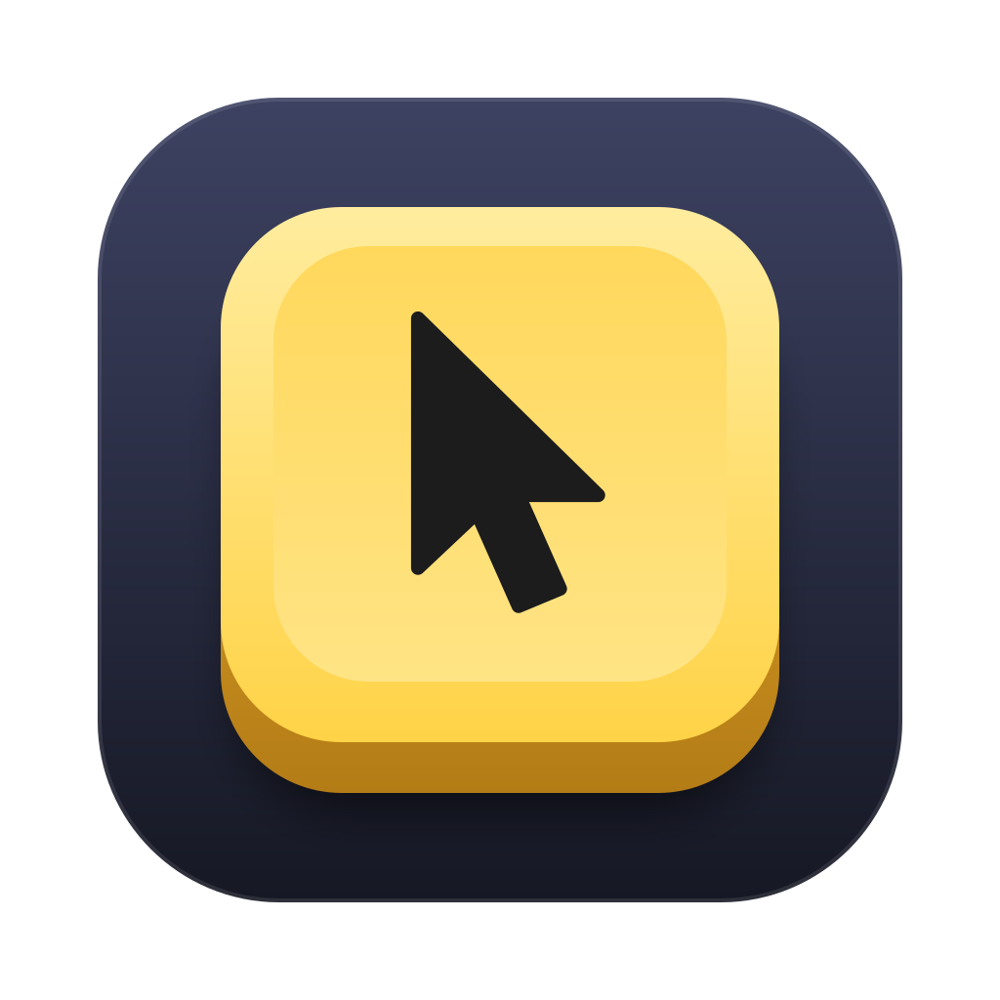
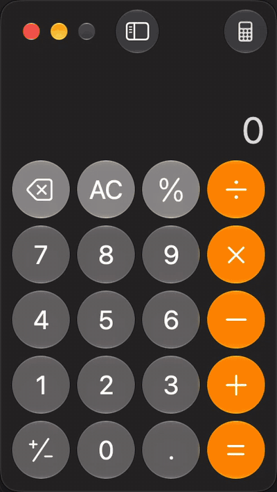
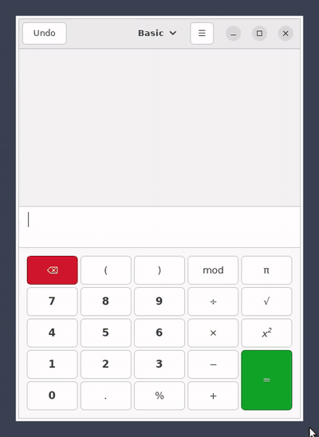
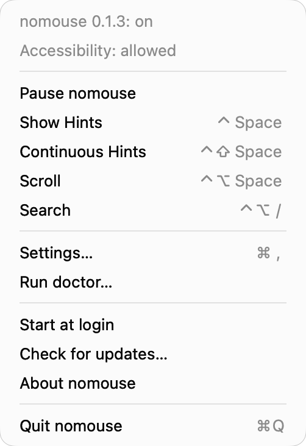
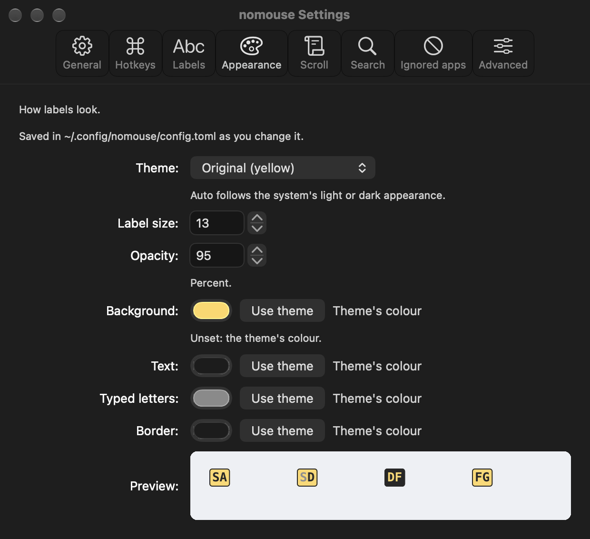
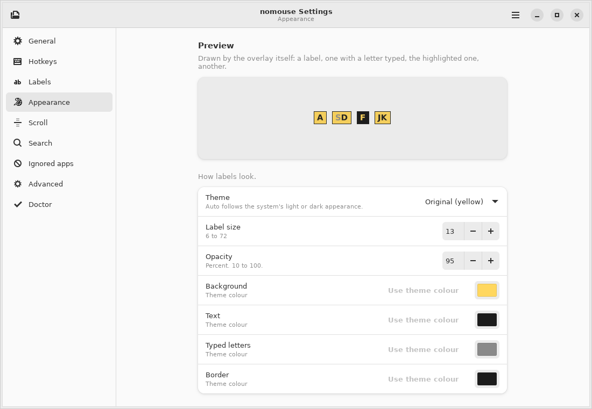
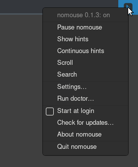

<p align="center">
  
</p>

# nomouse

**Click anything on screen without touching the mouse.** A free, open-source
[Homerow](https://www.homerow.app/) alternative for macOS and Linux, written in Rust.

Press a hotkey, and every button, link, tab and field gets a short label. Type the label and
nomouse clicks it.

<p align="center">
  
</p>

## Install

```sh
curl -fsSLO --retry 5 --retry-all-errors https://github.com/yuyudhan/nomouse/releases/latest/download/install.sh && bash install.sh
```

One command for macOS 11+ (Apple silicon and Intel) and Linux (x86_64 and aarch64, glibc 2.35+,
X11 and Wayland). It saves `install.sh` in the current folder, then runs it only if the download
worked. No sudo: it verifies the download's SHA-256, installs `nomouse.app` on macOS or the
`nomouse` binary in `~/.local/bin` on Linux, and prints the next step for your system.

Debian and Ubuntu `.deb` packages, the Windows build (x86_64, and Windows 11 on ARM through
emulation), every installer option: [docs/install.md](docs/install.md).

From source, with Rust 1.95 or newer (`rustup update stable` first):
`cargo install --locked --git https://github.com/yuyudhan/nomouse nomouse` (on Linux add
`nomouse-settings` for the settings window). That installs only the command, without the macOS
app or the Linux launcher entry; the prerequisites, and how to build the app, are in
[Building from source](docs/install.md#building-from-source).

## First use, in 30 seconds

1. **Start it and allow it.**
   - macOS: `open /Applications/nomouse.app`. Its keycap icon appears in the menu bar and a
     Welcome window asks for **Accessibility** (System Settings › Privacy & Security ›
     Accessibility, called Device Control and Data Access on macOS 27 › switch on nomouse); it
     restarts itself once allowed. Until releases are Developer ID signed, macOS asks again
     after every update ([why, and the steps](docs/install.md#updating)).
   - Linux X11: `nomouse setup`, then pick **nomouse** in the app launcher (Super, type
     `nomouse`): it starts the daemon and opens its settings. `nomouse` in a terminal works too.
   - Linux Wayland: bind the modes in your compositor, e.g. Sway:
     `bindsym Ctrl+space exec nomouse hints` and `exec nomouse daemon`
     ([Hyprland, KDE](docs/install.md#linux-wayland)).
2. **Press `ctrl+space`.** Yellow labels appear on everything clickable in the focused window,
   each in the middle of its element.
3. **Type a label** (`dh`): nomouse clicks that element. Escape cancels.
4. **Scroll**: `ctrl+alt+space`, then `j` `k` to scroll, `gg` / `G` for top and bottom.
5. **Search**: `ctrl+alt+/`, type part of a button's text, Enter clicks the best match.

| Hotkey | Mode |
|--------|------|
| `ctrl+space` | **hints**: label the window, type a label to click |
| `ctrl+shift+space` | **continuous**: keep labelling after every click (the demo above) |
| `ctrl+alt+space` | **scroll**: pick a scrollable area and scroll it with `h` `j` `k` `l` |
| `ctrl+alt+/` | **search**: find an element by its text |

While labels are up: `1`–`4` hold Shift, Ctrl, Alt or Cmd for the click (`4` then a link's
label opens it in a new tab on macOS), Tab and Return pick the highlighted label, Backspace
undoes a letter. Every key: [docs/usage.md](docs/usage.md).

<p align="center">
  
</p>

## Why nomouse

| | nomouse | Homerow |
|---|---|---|
| Price and source | free, open source (MIT or Apache-2.0) | paid, closed source |
| macOS | yes | yes |
| Linux: X11, and Wayland on Sway and Hyprland (KDE in part) | yes | no |
| Labels on every clickable element | yes | yes |
| Search by text, best match first | yes | yes |
| Scroll mode with `h` `j` `k` `l`, `gg`, `G` | yes | yes |
| Right-click, double-click, cmd-click | yes | yes |
| Drag and hover | yes | not documented |
| Continuous mode (Homerow's click chain) | yes | yes |
| Homerow's own key bindings | yes (`hints.keys = "homerow"`) | yes |
| Click without moving the pointer | yes (`hints.semantic_click`) | not documented |
| Labels on every window of every monitor | yes (`hints.scope = "screen"`) | not documented |
| Ignored apps, label themes (light, dark, auto) | yes | yes |
| Plain-text config for your dotfiles | `~/.config/nomouse/config.toml` | settings window |
| Menu bar icon, settings window, launch at login from the app | yes (macOS menu bar, Linux tray) | yes (macOS) |

Each feature and its status per OS: [docs/features.md](docs/features.md).

## Configuration

nomouse needs no config. To change something, `nomouse config init` writes
`~/.config/nomouse/config.toml` with every default; keep only what you change. A running daemon
picks up a saved file within two seconds.

```toml
[hints]
alphabet = "fjdksagh"      # label letters, most comfortable first
keys = "homerow"           # a label highlights; Return clicks, as in Homerow

[hotkeys]
hints = "cmd+shift+space"

[overlay]
theme = "auto"             # light or dark labels, following the system

[ignore]
apps = ["com.mitchellh.ghostty", "kitty"]
```

Every key, its default and its range: [docs/configuration.md](docs/configuration.md).

## Menu bar and settings

Both settings windows edit that same file and save each change at once, writing only what
differs from the defaults and keeping your comments; the daemon picks it up within a second.
Edit by hand and in the window freely.

**macOS.** nomouse.app lives in the menu bar (no Dock icon), like Homerow. Its keycap icon
opens a menu with the state and the Accessibility status (with a button to fix it), Pause,
each mode with its hotkey, **Settings…**, **Run doctor…**, **Start at login**, **Check for
updates…** (opens the download page when a newer release exists), About and Quit. The
settings window has a page for every setting: hotkeys recorded by pressing them (a clash with
a macOS shortcut is flagged), label letters and the Homerow key bindings, appearance with a
live preview, scrolling, browser mode, ignored apps picked from `/Applications`, and advanced
options with **Open Config File** and **Reset to Defaults…**. The first start walks through
the Accessibility grant in a Welcome window. All of it: [docs/usage.md](docs/usage.md#menu-bar-and-settings).

<p align="center">
  
  
</p>

Every macOS page in light and dark: `docs/media/macos/settings-<page>-<light|dark>.png`.

**Linux.** The settings window opens from the app launcher's nomouse, the tray menu's
**Settings…**, or `nomouse-settings`: hotkeys recorded by pressing them, label letters, the
label theme with a live preview, scrolling, search, ignored apps and start at login. The tray
icon's menu pauses nomouse, starts each mode and runs the doctor; on GNOME it shows with the
AppIndicator extension, on by default on Ubuntu.

<p align="center">
  
  
</p>

Every Linux page in light and dark: `docs/media/settings-<page>-<light|dark>.png`.

## Uninstall

```sh
curl -fsSLO https://github.com/yuyudhan/nomouse/releases/latest/download/install.sh && bash install.sh --uninstall
```

Removes the app or binary and keeps your config (add `--purge` to delete it too). On macOS,
also remove nomouse's Accessibility entry: `tccutil reset Accessibility com.yuyudhan.nomouse`.

## Troubleshooting

`nomouse doctor` checks permissions, the accessibility API, input and the config, and prints
the fix for anything missing.

| Symptom | Fix |
|---------|-----|
| macOS: `ctrl+space` does nothing | allow nomouse in Privacy & Security › Accessibility (Device Control and Data Access on macOS 27); if you use several keyboard layouts, macOS owns `ctrl+space`: free it or pick another hotkey |
| macOS: switched on, but nomouse still asks (after an update) | click **Open System Settings** in its Welcome window and switch the new entry on; [by hand](docs/install.md#allowing-nomouse-again-after-an-update-macos) |
| No labels in Chrome, Slack, VS Code | macOS: list them in `macos.enhanced_ui_apps`; Linux: start them with `--force-renderer-accessibility` |
| No labels in Qt apps on Linux | `QT_LINUX_ACCESSIBILITY_ALWAYS_ON=1` in your session |
| Wayland: the hotkey does nothing | Wayland has no global hotkeys for apps: bind `nomouse hints` in your compositor |
| GNOME on Wayland | not supported yet: choose "GNOME on Xorg" ("Ubuntu on Xorg" on Ubuntu) under the gear at login |
| KDE Wayland: labels but no clicks | allow `/dev/uinput` with the [udev rule](docs/install.md#linux-wayland) |

More in [docs/troubleshooting.md](docs/troubleshooting.md); each compositor in
[docs/platform-support.md](docs/platform-support.md).

## Documentation

[Install](docs/install.md) · [Usage](docs/usage.md) · [Configuration](docs/configuration.md) ·
[Troubleshooting](docs/troubleshooting.md) · [Platform support](docs/platform-support.md) ·
[Architecture](docs/architecture.md) · [All docs](docs/README.md) ·
[Changelog](CHANGELOG.md)

## Contributing

```sh
rustup toolchain install && cargo install just taplo-cli typos-cli cargo-deny --locked
just install-hooks
just check && just test
```

The rules (no unsafe outside the two FFI crates, clippy pedantic with `-D warnings`, tests with
every change) are in [CONTRIBUTING.md](CONTRIBUTING.md), the test layers in
[docs/testing.md](docs/testing.md), and the rules for coding agents in [AGENTS.md](AGENTS.md).

`just dev` and `just app` build a development nomouse ("nomouse Dev.app" on macOS) that runs
beside the installed one with its own config, hotkeys and Accessibility grant:
[CONTRIBUTING.md](CONTRIBUTING.md#development-builds).

## License

Licensed under either of [Apache License, Version 2.0](LICENSE-APACHE) or
[MIT license](LICENSE-MIT), at your option. Unless you explicitly state otherwise, any
contribution intentionally submitted for inclusion in the work by you, as defined in the
Apache-2.0 license, shall be dual licensed as above, without any additional terms or conditions.
